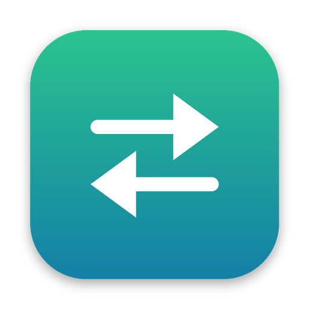
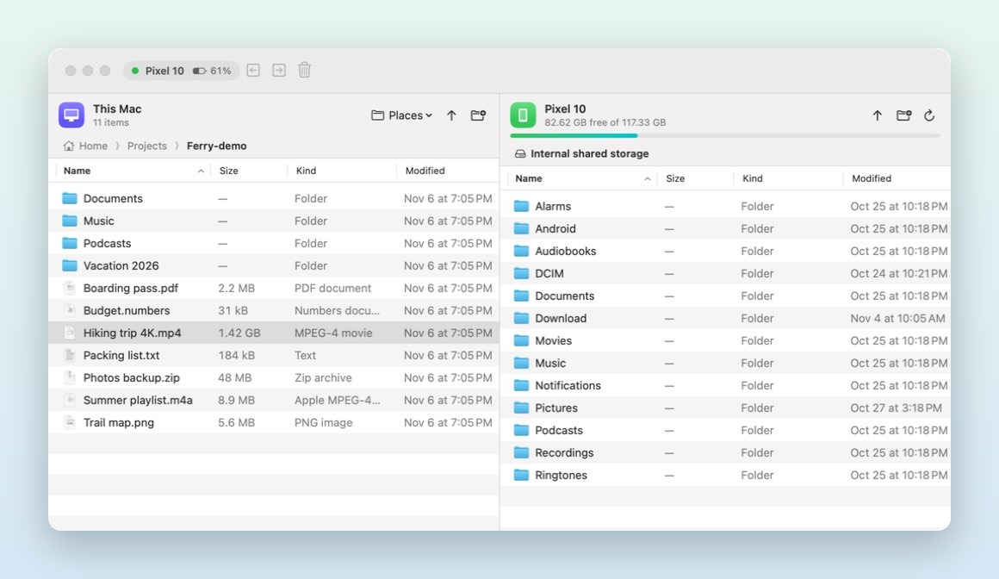
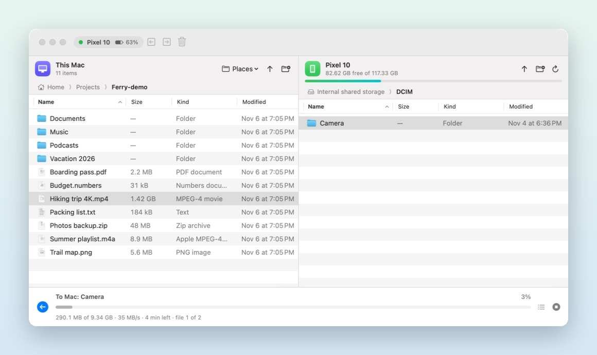

<p align="center">
  
</p>

<h1 align="center">Ferry</h1>

<p align="center">
  <b>Fast, native Android file transfer for macOS.</b><br>
  Plug in your phone, drag files across. That's it.
</p>

<p align="center">
  <a href="https://github.com/Walker123t/ferry/releases/latest/download/Ferry.dmg"><b>⬇︎ Download Ferry</b></a>
  &nbsp;·&nbsp;
  <a href="https://walker123t.github.io/ferry/">Website</a>
  &nbsp;·&nbsp;
  <a href="#build-from-source">Build from source</a>
</p>

<p align="center">
  <a href="https://github.com/Walker123t/ferry/actions/workflows/build.yml"></a>
  
  
  
</p>

<p align="center">
  
</p>

## Why Ferry?

macOS doesn't speak MTP, the protocol Android phones use over USB. Google's *Android File Transfer*
is discontinued and flaky, and the alternatives are either paid or built on Electron.
Ferry is a small, native SwiftUI app that does one job well.

- **Native and light.** SwiftUI, no Electron and no bundled browser. It opens instantly and barely uses memory.
- **Side by side.** Your Mac on the left, your phone on the right. Drag between them, or drop files straight from Finder.
- **Big files and whole folders.** Copies files over 4 GB and entire folder trees, keeping modified dates.
- **Clear progress.** Live speed, time remaining and file count, with a queue and a cancel button.
- **Plug and play.** Finds your phone automatically and reconnects if the cable comes loose.
- **Internal storage and SD cards**, with a free-space bar and battery level.
- **Finder-style browsing.** Real file icons, a Kind column, sortable columns, breadcrumbs, rename, new folder and delete.

<p align="center">
  
</p>

## Install

**Download:** grab [**Ferry.dmg**](https://github.com/Walker123t/ferry/releases/latest/download/Ferry.dmg), open it, and drag Ferry to Applications.

**Homebrew:**
```sh
brew install --cask walker123t/tap/ferry
```

Then plug in your phone, unlock it, tap the **USB** notification and choose **File transfer**.

Ferry is signed with a Developer ID and notarized by Apple. It requires a Mac with Apple silicon running macOS 15 Sequoia or later.

## Using Ferry

| To do this | Do this |
| --- | --- |
| Copy Mac → phone | Drag to the right side, drop from Finder, double-click a file, or press **⌥⌘→** |
| Copy phone → Mac | Drag to the left side, double-click a file, or press **⌥⌘←** |
| Open a folder | Double-click it, or press Return |
| New folder on phone / Mac | **⇧⌘N** / **⌥⌘N** |
| Delete from phone / Move to Trash on Mac | Delete key |
| Refresh | **⌘R** |
| Show hidden files | **⇧⌘.** |

Files are copied into whichever folder is open on the other side.

**Phone shows as "busy"?** Another app is holding the USB connection. Quit Android File Transfer,
OpenMTP or Image Capture, or click **Quit Apps Holding the Phone** in Ferry.

## Build from source

You need Xcode (or the Command Line Tools) and [Homebrew](https://brew.sh).

```sh
git clone https://github.com/Walker123t/ferry.git
cd ferry
./"Build and Run.command"
```

The script installs `libmtp` with Homebrew the first time, compiles with Swift Package Manager,
creates `build/Ferry.app` and opens it. You can also just double-click **Build and Run.command** in Finder.

Every push is built by [GitHub Actions](.github/workflows/build.yml). Tagged releases (`v*`) bundle
libmtp and libusb into the app, sign and notarize it, publish `Ferry.dmg` to
[Releases](https://github.com/Walker123t/ferry/releases), and update the Homebrew tap.

### How it works

```
Sources/
├── CLibMTP/         Swift module map for libmtp (via pkg-config)
└── Ferry/
    ├── MTP/         MTPSession: all libmtp calls on one serial queue
    ├── Model/       AppModel (connection, browsing, copy planning) and TransferJob
    └── Views/       SwiftUI: Mac pane, phone pane, transfer bar, connect screen
```

MTP only does one thing at a time, so Ferry runs every device call on a single serial queue and
wraps it in `async`/`await`. Copies are planned up front (walking folders to get the total size),
then streamed file by file with throttled progress updates back to the UI.

## Credits

Inspired by [OpenMTP](https://github.com/ganeshrvel/openmtp). Talks to devices with
[libmtp](https://github.com/libmtp/libmtp) (LGPL-2.1), which is loaded as a separate dynamic library.

## License

[MIT](LICENSE) © 2026 Trevor Walker
